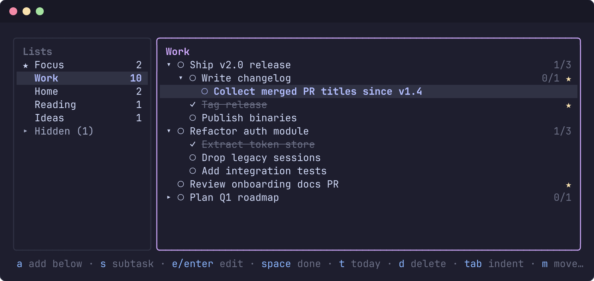
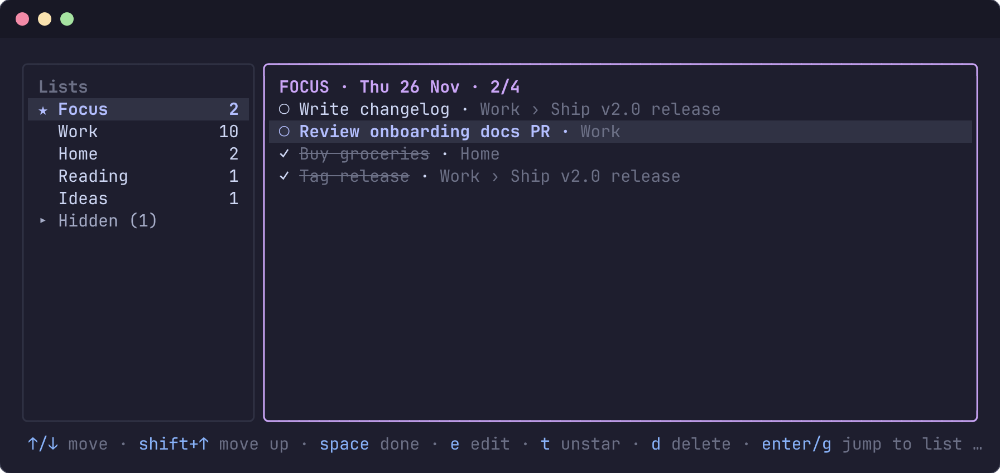
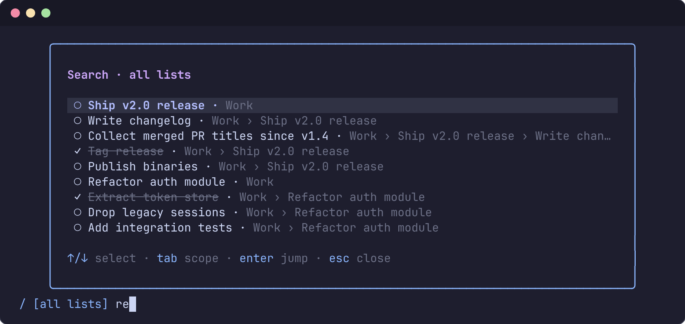
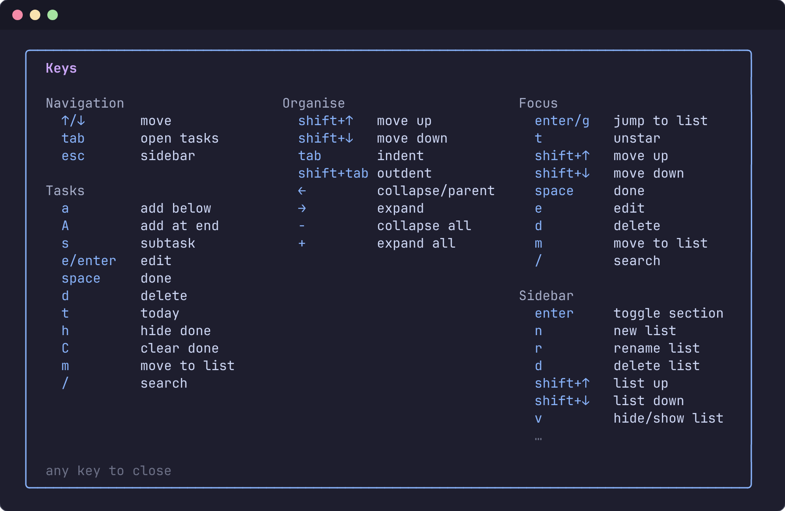

# task-tui

[](https://pkg.go.dev/github.com/hqazi/task-tui)
[](go.mod)
[](LICENSE)

A fast, keyboard-driven task manager for the terminal, built around lists, nested tasks and a daily Focus view.



## Features

- **Lists** to group work, with reordering, renaming and hiding.
- **Nested tasks** to any depth, with collapse, indent and outdent, and progress counts on parent tasks.
- **Focus view** that gathers every task starred for today, from any list, in an order you control.
- **Search** across the current list or all lists, with breadcrumbs to each match.
- **Plain JSON storage** in a single human-readable file, saved atomically on every change.
- **Single binary** with no runtime dependencies, built with [Bubble Tea](https://github.com/charmbracelet/bubbletea), [Lip Gloss](https://github.com/charmbracelet/lipgloss) and [Bubbles](https://github.com/charmbracelet/bubbles).
- **ASCII fallback** for terminals without good Unicode support.

## Installation

task-tui requires Go 1.24 or newer.

```sh
go install github.com/hqazi/task-tui/cmd/task-tui@latest
```

To build from source:

```sh
git clone https://github.com/hqazi/task-tui.git
cd task-tui
go build -o task-tui ./cmd/task-tui
```

## Usage

```sh
task-tui [--file path]
```

| Option | Description |
|---|---|
| `--file path` | Use a different data file instead of the default location. |

| Environment variable | Description |
|---|---|
| `XDG_DATA_HOME` | Base directory for the default data file. |
| `TASK_TUI_ASCII=1` | Replace Unicode icons and rounded borders with ASCII equivalents. |

Press `?` at any time to see every key binding.

## Focus view

Focus is a virtual list pinned to the top of the sidebar. It collects every task you star with `f`, from any list and at any depth (including hidden lists), and shows where each one lives.



- Focus keeps its own manual order (`shift+up` / `shift+down`), independent of each list. Newly starred tasks are added to the bottom.
- Completing, editing, unstarring, moving or deleting a task in Focus acts on the original task. `enter` or `g` jumps to it in its home list.
- Stars are never cleared automatically. A task leaves Focus when you unstar it, or on the day after you complete it. Completed tasks remain visible, struck through, for the rest of that day.
- The header shows today's date and progress, for example `FOCUS · Thu 26 Nov · 2/4`.

## Search

Press `/` to search the current list. Press `tab` inside the search popup to switch between the current list and all lists, and `enter` to jump to the selected task.



## Key bindings

The in-app help (`?`) lists the same bindings.



<details>
<summary>Sidebar</summary>

| Key | Action |
|---|---|
| `up` / `down` | Move selection |
| `tab`, `right`, `enter` | Open the selected list |
| `n` | New list |
| `r` | Rename list |
| `D` | Delete list (always asks for confirmation) |
| `shift+up` / `shift+down` | Move list up / down |
| `v` | Hide or show list |
| `enter` on "Hidden (n)" | Expand or collapse the hidden section |
| `?` | Help |
| `q` | Quit |

</details>

<details>
<summary>Tasks</summary>

| Key | Action |
|---|---|
| `up` / `down` | Move selection |
| `esc` | Back to sidebar |
| `a` | Add task below |
| `A` | Add task at end of list |
| `s` | Add subtask |
| `e` / `enter` | Edit task |
| `d` / `space` | Toggle done (also completes all subtasks) |
| `D` | Delete task (asks if it has subtasks) |
| `f` | Star or unstar for Focus |
| `h` | Hide or show completed tasks |
| `C` | Clear completed tasks (asks for confirmation) |
| `m` | Move to another list |
| `/` | Search |
| `shift+up` / `shift+down` | Move task up / down |
| `tab` / `shift+tab` | Indent / outdent |
| `left` | Collapse, or jump to parent |
| `right` | Expand |
| `-` / `+` | Collapse all / expand all |
| `?` | Help |
| `q` | Quit |

</details>

<details>
<summary>Focus</summary>

| Key | Action |
|---|---|
| `up` / `down` | Move selection |
| `enter` / `g` | Jump to the task in its list |
| `f` | Unstar |
| `shift+up` / `shift+down` | Move task up / down in Focus |
| `d` / `space` | Toggle done |
| `e` | Edit task |
| `D` | Delete task |
| `m` | Move to another list |
| `/` | Search |
| `esc` | Back to sidebar |
| `?` | Help |
| `q` | Quit |

</details>

<details>
<summary>Popups</summary>

| Popup | Keys |
|---|---|
| Text input | `enter` save, `esc` cancel |
| Confirmation | `y` yes, `n` or `esc` no |
| Move to list | `up` / `down` choose, `enter` move, `esc` cancel |
| Search | type to filter, `up` / `down` select, `tab` switch scope, `enter` jump, `esc` close |
| Help | any key closes |

</details>

## Data storage

Tasks are stored in a single JSON file:

1. The path given with `--file`, if set.
2. Otherwise `$XDG_DATA_HOME/task-tui/tasks.json`.
3. Otherwise `~/.local/share/task-tui/tasks.json`.

If the file does not exist, task-tui starts with an empty store containing one list named "Inbox". Every change is written immediately using a temporary file and an atomic rename, so the file is never left half-written. The format is indented, versioned JSON and is safe to read, back up or keep under version control.

## Development

```sh
go test ./...
go vet ./...
```

The code is organised into three packages:

| Package | Responsibility |
|---|---|
| `internal/model` | Domain model: lists, nested tasks, Focus ordering. No I/O or UI dependencies. |
| `internal/store` | Loading and atomically saving the JSON file. |
| `internal/ui` | The Bubble Tea application, views and key handling. |

The original design notes are in [REQUIREMENTS.md](REQUIREMENTS.md) and [TASKS.md](TASKS.md).

## Contributing

Bug reports and pull requests are welcome. Please open an issue to discuss larger changes before starting work, and make sure `go test ./...` and `go vet ./...` pass before submitting.

## License

task-tui is licensed under the [Apache License 2.0](LICENSE).
